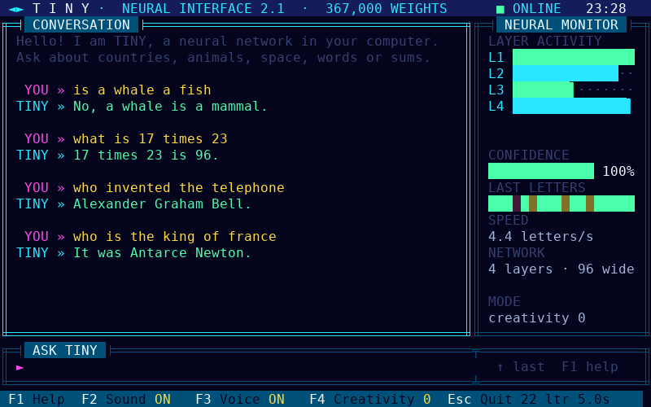

# TINY 2.1: a tiny transformer with a terminal interface



TINY is a small question-answering transformer that reads and writes one
letter at a time. Version 2.1 began as a Turbo C program for DOS. It is now
split into:

- a **portable C99 core** (`core/`): no heap, no stdio, no globals.
  Meant to be ported to embedded platforms.
- a **Textual terminal interface** in Python (`tui/`). It has the neon look
  of the DOS version: chat, a live neural monitor and letter-by-letter
  decoding.
- a **plain command-line front end** in C (`cli/`), for scripting and as
  an example of using the core.

About the network:

- 367,000 parameters: 4 layers, 96 wide, 4 heads, 256-wide feed-forward
- 8-bit weights (one scale per row), 380 KB in all (`model/TINY.BIN`)
- Trained on about 3,500 facts, each asked in many wordings.
  Outside those it makes things up confidently.

Written by Fable 5.2 and trained by Opus 5.5.

## Build and run

Needs a C compiler, `make` and Python 3.9+.

```
make                                   # build/libtiny.{dylib,so} and build/tiny
python3 -m venv .venv && .venv/bin/pip install -r requirements.txt
.venv/bin/python -m tui                # full-screen terminal interface
```

Options for the terminal interface (`python -m tui --help`):

```
python -m tui 0          creativity 0: always the surest answer (best for quizzes and sums)
python -m tui 5          the default: answers are worded differently each time
python -m tui 9          the most varied (and makes more mistakes)
python -m tui --demo     TINY asks itself sample questions; press a key to take over
python -m tui --fast     no letter-by-letter animation
python -m tui --seed 42  repeatable answers
python -m tui --model other.bin
```

Keys: `F1` help, `F4` creativity 0–9, `↑` last question, `Esc` quit.
Words: `HELP`, `CLS` (clear the chat), `QUIT`.

The **neural monitor** shows the network working, live:

- layer activity: how busy each layer is for every letter
- confidence: how sure TINY is of the letter it just chose
  (green sure, amber unsure, red guessing)
- last letters: the same for the last 18 letters
- speed: letters per second inside the C core (question and answer)

Plain text, for pipes and scripts:

```
build/tiny 0 < questions.txt > answers.txt
build/tiny [-m TINY.BIN] [-s SEED] [0-9]
```

## Layout

```
core/tiny.h, tiny.c   the transformer: model parsing, inference, sampling
cli/tiny_cli.c        plain stdin/stdout front end
tui/tiny.py           ctypes binding to build/libtiny
tui/app.py            Textual application
model/TINY.BIN        the trained network
tests/compare.sh      regression test against the original DOS code
training/             facts, data generator and PyTorch training script
dos/                  the original DOS version (legacy, to be removed)
```

## The C core API

`core/tiny.c` needs only `<math.h>` (`sqrtf`, `expf`), `<string.h>`
(`memcpy`) and `<stdint.h>`. It never allocates memory, does no I/O and
never exits.

- **Weights stay in place.** `tiny_model_init` parses a `TINY.BIN` image
  and keeps pointers into it, so the image can stay in flash or ROM. Data
  is read byte by byte (little-endian, any alignment).
- **RAM comes from the caller.**
  - `tiny_ctx_mem_size()` is the size of the cache of earlier letters:
    about 100 KB for this network.
  - The `tiny_ctx` struct itself is about 6 KB.
  - Shrink the struct with `-DTINY_MAXD=96 -DTINY_MAXHID=256 -DTINY_MAXL=4`.
- **Step by step.** The caller drives the loop, with no callbacks, so a UI
  can animate and an embedded loop can yield between letters.
- **Repeatable.** It has its own xorshift random generator (`tiny_seed`),
  so answers are the same on every platform.
- **Reentrant.** All state lives in `tiny_model` (read only, can be shared)
  and `tiny_ctx`.

```c
#include "tiny.h"

static tiny_model m;
static tiny_ctx   c;
static uint8_t    cache[110000];          /* >= tiny_ctx_mem_size(&m) */

tiny_model_init(&m, tiny_bin, tiny_bin_len);
tiny_ctx_init(&c, &m, cache, sizeof cache);
tiny_set_creativity(&c, 0);

char q[TINY_MAXQ + 1];
tiny_clean("What is the capital of Peru", q);
tiny_reset(&c);
for (const char *p = q; *p; p++) tiny_feed(&c, *p);
tiny_end_question(&c);
int ch;
while ((ch = tiny_next(&c)) > 0) putchar(ch);   /* "Lima." */
/* tiny_confidence(&c), tiny_layer_activity(&c, l) for monitoring */
```

`tiny_answer(&c, question, out, max)` does all of the above in one call.
Every function returns a negative `TINY_ERR_*` code on error;
`tiny_strerror` explains it.

## Tests

```
make test
```

This builds the original `dos/TINY.C` in its plain-text mode with the host
compiler. It then asks both programs the questions in `tests/questions.txt`
at creativity 0 and checks that the answers are identical.

## Train it yourself

The `training` folder is the complete training kit:

- the facts
- the generator that turns them into question/answer pairs in many
  wordings (`gen2.py`)
- the PyTorch training script (`train2.py`)

It needs Python 3, NumPy and PyTorch; a normal CPU is enough.

```
cd training
python3 gen2.py                                   # show sample questions
python3 train2.py train 60 more.pt --resume tiny2.pt --lr 5e-4 --decay 0.3 --eval-every 20
python3 train2.py eval more.pt
python3 train2.py export more.pt ../model/TINY.BIN
```

Add your own facts to `training/facts/` (the format is in
`training/TRAINING.TXT`). Exporting `tiny2.pt` unchanged gives exactly the
released `TINY.BIN`. The core reads the network size from the file header,
so a retrained network of another size works without recompiling, within
the `TINY_MAX*` limits.

## Licence

Code: MIT (`LICENSE`). Three data files derived from public datasets keep
their own licences (ODbL and CC BY-SA); see `DATA_LICENSES.md`.
